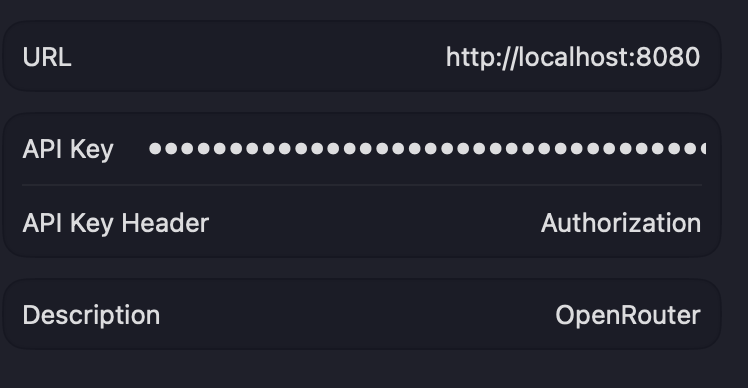
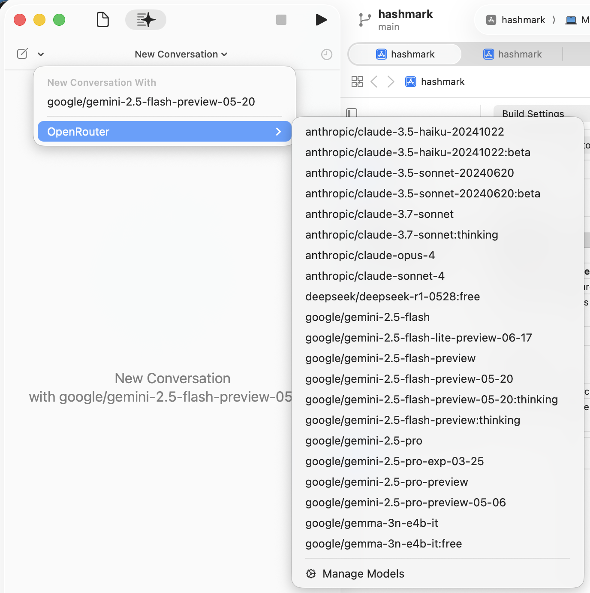
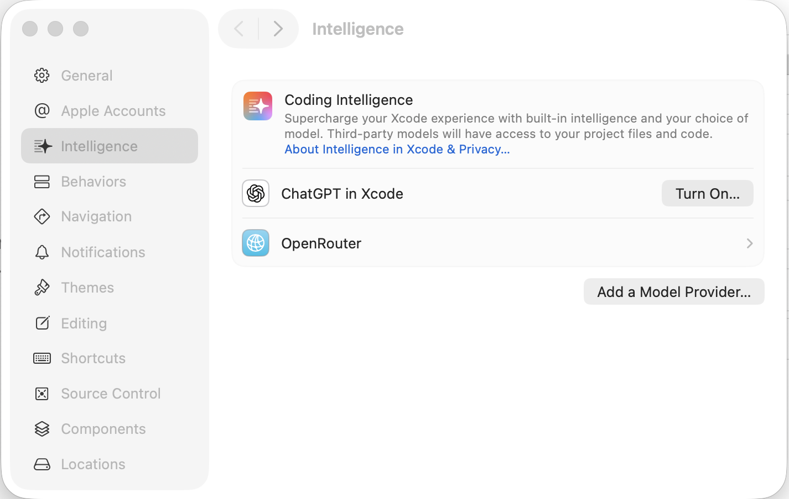
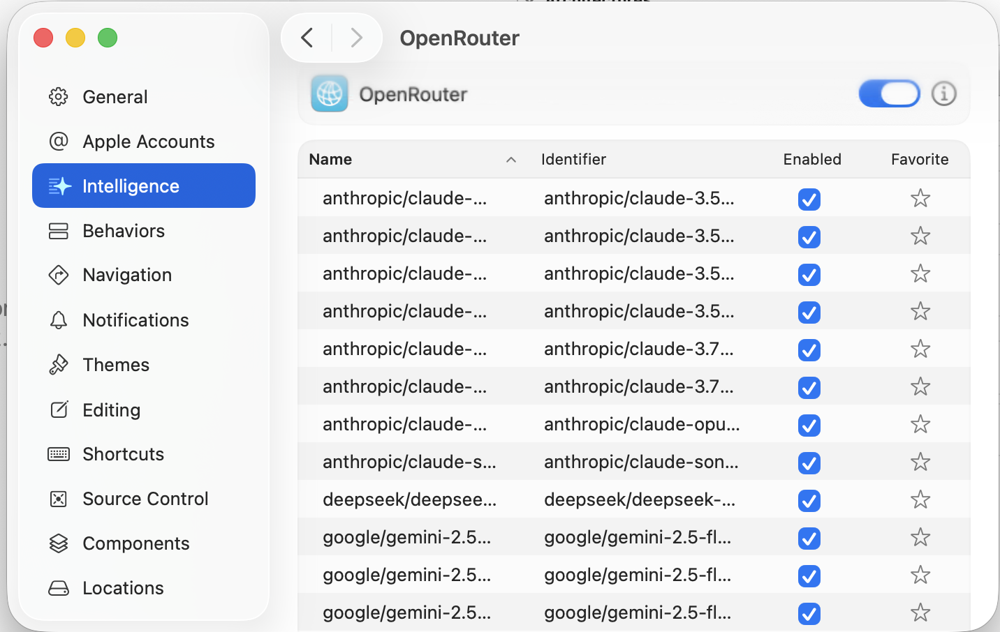

# OpenRouter Proxy for Xcode 26 Beta

[](LICENSE)
[](https://www.python.org/)

A compatibility layer that enables Xcode 26 Beta's native AI integration to work with [OpenRouter](https://openrouter.ai/) models. This proxy transforms OpenRouter API responses into OpenAI-compatible format, acting as a bridge between Xcode and OpenRouter's extensive model catalog.

## Table of Contents
- [Features](#features)
- [Quick Start](#quick-start)
- [Setup](#setup)
  - [Docker Deployment](#docker-deployment)
  - [Standalone Executable](#standalone-executable-deployment)
- [Configuration](#configuration)
  - [Environment Variables](#environment-variables)
  - [Model Filtering](#model-filtering)
- [Xcode Integration](#xcode-integration)
- [API Documentation](#api-documentation)
- [Troubleshooting](#troubleshooting)
- [Development](#development)
- [Contributing](#contributing)
- [License](#license)

## Features

- **OpenAI-Compatible API**: Transforms OpenRouter responses to OpenAI format for seamless Xcode integration
- **Model Filtering**: Whitelist specific models using patterns (supports wildcards like `google/*`, `anthropic/claude-*`)
- **Streaming Support**: Full support for streaming chat completions
- **Multiple Deployment Options**: Docker, Docker Compose, or standalone executable
- **Comprehensive Logging**: Request/response logging for debugging and monitoring
- **SSL Flexibility**: Optional SSL verification toggle for debugging with proxies
- **Error Handling**: Graceful error handling with OpenAI-formatted error responses
- **Production Ready**: Containerized, tested, and ready for deployment

## Quick Start

The fastest way to get started:

```bash
# Clone the repository
git clone https://github.com/OhJayGee/OpenRouterXcodeProxy.git
cd OpenRouterXcodeProxy

# Start with Docker Compose
docker-compose up

# Configure Xcode (Settings > Intelligence > Add Model Provider):
# - URL: http://localhost:8080
# - API Key: Bearer sk-or-v1-... (your OpenRouter API key)
# - API Key Header: Authorization
```

That's it! Xcode can now use OpenRouter models.

## Setup

### Docker Deployment
#### Option 1: Docker Compose (Recommended)
1. Create docker-compose.yml (already created in project)
2. Start the service:
```bash
docker-compose up
```

To use a different host port (e.g., 9090):
```bash
HOST_PORT=9090 docker-compose up
```

#### Option 2: Manual Docker Commands
1. Build the Docker image:
```bash
docker build -t openrouter-proxy ./proxy
```

2. Run the container:
```bash
docker run --rm -p ${HOST_PORT:-8080}:8080 openrouter-proxy
```

### Standalone Executable Deployment
1. Make the build script executable:
```bash
chmod +x build_executable.sh
```

2. Build the standalone executable:
```bash
./build_executable.sh
```

3. Run the executable (default port 8080):
```bash
./proxy/dist/app
```

To run on a different port (e.g., 9090):
```bash
PORT=9090 ./proxy/dist/app
```

## Configuration

### Environment Variables

| Variable | Description | Default | Example |
|----------|-------------|---------|---------|
| `PORT` | Server listening port | `8080` | `PORT=9090` |
| `DISABLE_SSL_VERIFY` | Disable SSL verification (debugging only) | `false` | `DISABLE_SSL_VERIFY=true` |
| `MODEL_FILTER_FILE` | Path to model filter file | `filter-models.txt` | `MODEL_FILTER_FILE=/path/to/models.txt` |
| `HOST_PORT` | Docker Compose host port mapping | `8080` | `HOST_PORT=9090` |

**Security Warning**: Only set `DISABLE_SSL_VERIFY=true` for local debugging with tools like Proxyman. Never use in production.

### Model Filtering

Control which models are available to Xcode by creating a filter file (one model ID per line). Supports wildcard patterns:

```text
# Specific models
anthropic/claude-3.7-sonnet
deepseek/deepseek-r1-0528:free

# Wildcard patterns
anthropic/claude-*4*     # All Claude models with "4" in the name
google/gemini-2.5*       # All Gemini 2.5 models
openai/*                 # All OpenAI models
```

The default `filter-models.txt` includes:
- Claude 3.7 Sonnet and Claude models with "4"
- DeepSeek R1
- Google Gemini 2.5 and Gemma models
- OpenAI GPT-4 models
- Z-AI GLM-4.5

To use all models without filtering, remove or rename `filter-models.txt`.

## Xcode Integration

### Adding OpenRouter as a Model Provider

1. Open Xcode Settings (⌘,)
2. Navigate to **Intelligence** tab
3. Click **Add a Model Provider...**
4. Configure:
   - **URL**: `http://localhost:8080`
   - **API Key**: `Bearer sk-or-v1-...` (your OpenRouter API key from [openrouter.ai](https://openrouter.ai/))
   - **API Key Header**: `Authorization`
   - **Description**: `OpenRouter` (or any name you prefer)



### Accessing Models in Xcode

Once configured, OpenRouter models appear in two locations:

**1. Intelligence Tab (Model Selector)**



**2. Intelligence Settings (Model Management)**



Click on the "OpenRouter" provider to:
- View all available models
- Enable/disable specific models
- Favorite your preferred coding models



### Best Practices for Xcode AI

1. **Use Model Filtering**: Xcode may struggle loading the complete OpenRouter catalog (200+ models). Use `filter-models.txt` to limit to your preferred models.

2. **Provide Context**: Add Apple documentation as Markdown files to help models understand modern Swift (Swift 6, SwiftUI, etc.)

3. **Structured Workflow**: For complex tasks, ask models to:
   - Write an Architecture & Design document
   - Create a Requirements document
   - Draft an Implementation plan
   - Then proceed with coding/testing

4. **Monitor Logs**: Check proxy logs to see Xcode's prompts, tool usage, and Swift Macro interactions.

## API Documentation

### GET /v1/models

Returns available models in OpenAI format.

**Request:**
```bash
curl http://localhost:8080/v1/models \
  -H "Authorization: Bearer sk-or-v1-..."
```

**Response:**
```json
{
  "object": "list",
  "data": [
    {
      "id": "anthropic/claude-3.7-sonnet",
      "object": "model",
      "created": 1234567890,
      "owned_by": "anthropic"
    }
  ]
}
```

### POST /v1/chat/completions

Proxies chat completion requests to OpenRouter.

**Request:**
```bash
curl http://localhost:8080/v1/chat/completions \
  -H "Authorization: Bearer sk-or-v1-..." \
  -H "Content-Type: application/json" \
  -d '{
    "model": "anthropic/claude-3.7-sonnet",
    "messages": [{"role": "user", "content": "Hello!"}],
    "stream": false
  }'
```

**Streaming:**
```bash
curl http://localhost:8080/v1/chat/completions \
  -H "Authorization: Bearer sk-or-v1-..." \
  -H "Content-Type: application/json" \
  -d '{
    "model": "anthropic/claude-3.7-sonnet",
    "messages": [{"role": "user", "content": "Hello!"}],
    "stream": true
  }'
```

See [API.md](API.md) for detailed API documentation.

## Troubleshooting

### Common Issues

#### Issue: Xcode can't load models

**Cause**: Too many models in the response (200+ from OpenRouter).

**Solution**: Enable model filtering:
```bash
# Create or edit filter-models.txt
echo "anthropic/claude-3.7-sonnet" > filter-models.txt
echo "openai/gpt-4" >> filter-models.txt
```

#### Issue: Connection refused / Cannot reach proxy

**Cause**: Proxy not running or wrong port.

**Solution**:
```bash
# Check if proxy is running
docker ps  # or
ps aux | grep app

# Check logs
docker-compose logs  # or
tail -f /path/to/proxy/logs
```

#### Issue: Authentication errors

**Cause**: Invalid or missing OpenRouter API key.

**Solution**:
- Get your API key from [openrouter.ai/keys](https://openrouter.ai/keys)
- Ensure you include `Bearer ` prefix: `Bearer sk-or-v1-...`
- Check the API key is set in Xcode settings

#### Issue: SSL certificate verification errors (with Proxyman)

**Cause**: Debugging proxy intercepts HTTPS requests.

**Solution**:
```bash
# Option 1: Disable SSL verification (debugging only)
DISABLE_SSL_VERIFY=true docker-compose up

# Option 2: Trust Proxyman certificate
# 1. Open Proxyman → Certificate → Install Certificate on This Mac
# 2. Open Keychain Access → Find "Proxyman" certificate
# 3. Set to "Always Trust"
```

#### Issue: Models not appearing in Xcode

**Cause**: Various configuration issues.

**Solution**:
1. Verify proxy is running: `curl http://localhost:8080/v1/models -H "Authorization: Bearer sk-or-v1-..."`
2. Check proxy logs for errors
3. Restart Xcode
4. Remove and re-add the model provider in Xcode settings

### Debugging

**View Proxy Logs:**
```bash
# Docker Compose
docker-compose logs -f

# Standalone executable
# Logs output to stdout/stderr
```

**Test Endpoints:**
```bash
# Test models endpoint
curl http://localhost:8080/v1/models \
  -H "Authorization: Bearer sk-or-v1-..." | jq

# Test chat completions
curl http://localhost:8080/v1/chat/completions \
  -H "Authorization: Bearer sk-or-v1-..." \
  -H "Content-Type: application/json" \
  -d '{"model":"anthropic/claude-3.7-sonnet","messages":[{"role":"user","content":"test"}]}' | jq
```

## Using with Proxyman (Debugging Proxy)

When using a debugging proxy like Proxyman, you might encounter SSL certificate verification errors. To resolve this:

1. Set the `DISABLE_SSL_VERIFY` environment variable to `true`:
```bash
# For Docker Compose
DISABLE_SSL_VERIFY=true docker-compose up

# For standalone executable
DISABLE_SSL_VERIFY=true ./proxy/dist/app
```

2. Trust Proxyman's root certificate in your system keychain (macOS):
   - Open Proxyman
   - Go to Certificate → Install Certificate on This Mac...
   - Follow prompts to add to System keychain
   - Open Keychain Access, find "Proxyman" certificate
   - Double-click it, expand Trust, and set "When using this certificate" to "Always Trust"

**Important Security Note:** Disabling SSL verification should only be done for debugging purposes. Never use this in production environments as it makes connections vulnerable to man-in-the-middle attacks.

## Development

### Running Tests

```bash
cd proxy
python -m pytest test_app.py -v
```

### Project Structure

```
OpenRouterXcodeProxy/
├── proxy/
│   ├── app.py              # Main Flask application
│   ├── test_app.py         # Unit tests
│   ├── requirements.txt    # Python dependencies
│   └── Dockerfile          # Container definition
├── docker-compose.yml      # Docker Compose configuration
├── build_executable.sh     # PyInstaller build script
├── filter-models.txt       # Model whitelist (supports wildcards)
├── images/                 # Screenshots for documentation
└── response-examples/      # Sample API responses
```

### Dependencies

- **Flask 3.0.0**: Web framework
- **requests 2.31.0**: HTTP client for OpenRouter API
- **waitress**: Production WSGI server
- **pytest**: Testing framework

### Building from Source

**Docker:**
```bash
cd proxy
docker build -t openrouter-proxy .
docker run -p 8080:8080 openrouter-proxy
```

**Standalone Executable:**
```bash
./build_executable.sh
./proxy/dist/app
```

## Contributing

Contributions are welcome! Please see [CONTRIBUTING.md](CONTRIBUTING.md) for guidelines.

### Quick Contribution Guide

1. Fork the repository
2. Create a feature branch (`git checkout -b feature/amazing-feature`)
3. Make your changes
4. Run tests (`pytest proxy/test_app.py`)
5. Commit changes (`git commit -m 'Add amazing feature'`)
6. Push to branch (`git push origin feature/amazing-feature`)
7. Open a Pull Request

## Architecture

For detailed architecture information, see [ARCHITECTURE.md](ARCHITECTURE.md).

### High-Level Overview

```
┌─────────┐         ┌──────────────────┐         ┌────────────┐
│  Xcode  │ ──────> │ OpenRouter Proxy │ ──────> │ OpenRouter │
│  26 Beta│         │  (This Project)  │         │    API     │
└─────────┘         └──────────────────┘         └────────────┘
     │                       │                          │
     │  OpenAI Format        │  Transform               │  OpenRouter
     │  Requests             │  Response                │  Format
     │                       │                          │
```

The proxy acts as a translation layer, converting between OpenAI's API format (expected by Xcode) and OpenRouter's API format.

## License

This project is licensed under the MIT License - see the [LICENSE](LICENSE) file for details.

## Acknowledgments

- [OpenRouter](https://openrouter.ai/) for providing unified access to multiple AI models
- Apple for Xcode 26 Beta's AI integration capabilities
- The open-source community for Flask, pytest, and other dependencies

## Support

- **Issues**: [GitHub Issues](https://github.com/OhJayGee/OpenRouterXcodeProxy/issues)
- **Discussions**: [GitHub Discussions](https://github.com/OhJayGee/OpenRouterXcodeProxy/discussions)
- **OpenRouter Support**: [OpenRouter Discord](https://discord.gg/openrouter)

## Roadmap

- [ ] Add rate limiting support
- [ ] Implement request caching
- [ ] Add metrics and monitoring endpoints
- [ ] Support for additional model providers
- [ ] WebUI for configuration and monitoring
- [ ] Health check endpoints
- [ ] Request/response transformation customization

---

**Made with ❤️ for the Xcode and AI development community**
